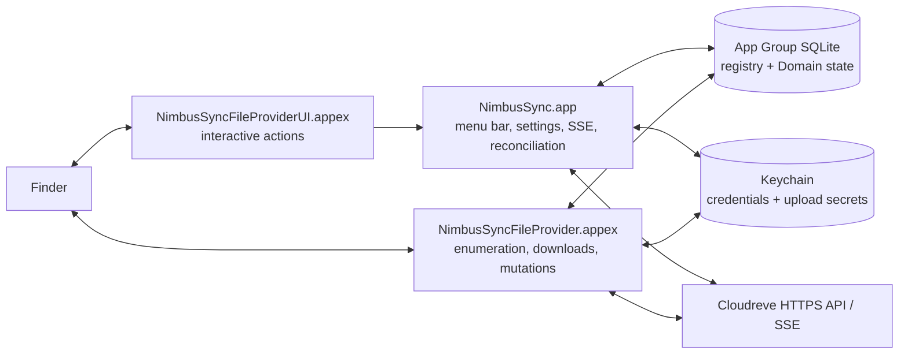

<div align="center">

<picture>
  <source media="(prefers-color-scheme: dark)" srcset="Design/AppIcon-Dark.png">
  
</picture>

# NimbusSync

**A native macOS File Provider client for self-hosted Cloudreve instances.**

[](#requirements)
[](#architecture)
[](#requirements)
[](LICENSE)

[English](README.md) | [简体中文](README_zh.md)


</div>

NimbusSync connects a macOS menu-bar application and Replicated File Provider
extensions to a self-hosted Cloudreve server. Each configured remote root is
represented as a File Provider Domain in the Finder sidebar, so Finder can
browse remote metadata and download file contents on demand while the client
keeps durable local state for recovery, events, and user-facing diagnostics.

> [!IMPORTANT]
> This is a source-first Technical Preview/Beta engineering repository, not a
> 1.0 release or a published Swift package. The local Swift, Xcode, and static
> security/release gates are implemented, but real Cloudreve
> mutation semantics, signed Finder end-to-end behavior, provider upload
> matrices, notarization, and long-run evidence are still unverified. The
> current Phase 4 release decision is **No-Go for 1.0**.

> [!NOTE]
> The complete Chinese product and architecture material lives in `docs/`. The
> English and Chinese READMEs intentionally stay aligned, but the deeper design
> documents remain Chinese-first at the moment.

## Current Status

The following status is based on the phase exit reports (2026-08-25), the
Phase 5 File Provider parity report (2026-09-05), and the current source tree.
It distinguishes local engineering evidence from external platform evidence:

| Area | Current status | Evidence or boundary |
| --- | --- | --- |
| Swift Store/Auth/File Provider/Event/Product modules | Verified locally | Swift package tests and Xcode Debug builds |
| Menu-bar app, Settings window, and extension targets | Implemented locally | `NimbusSync`, `NimbusSyncFileProvider`, `NimbusSyncFileProviderUI` |
| File Provider parity work (FP-001 to FP-012) | Implemented locally | See [`phase-5-nextcloud-parity-implementation.md`](docs/archive/reports/phase-5-nextcloud-parity-implementation.md); signed Finder evidence still pending |
| Real Cloudreve root/item identity and conditional writes | Unverified | Requires a controlled Cloudreve contract environment |
| Provider upload completion and resume matrix | Unverified | Enabled by the Cloudreve v4 baseline; still needs a real-server matrix |
| Signed Finder callback replay and File Provider E2E | Unverified | Requires signed extensions and real Finder evidence |
| Developer ID, notarization, Gatekeeper, clean-machine upgrade | Unverified | Release credentials and test machines are still required |
| 1.0 release candidate | No-Go | See [`phase-4-release-readiness.md`](docs/archive/reports/phase-4-release-readiness.md) |

The implementation keeps a `verified` / `unsupported` / `unverified`
capability model per Domain. New Domains are provisioned with the documented
Cloudreve v4 baseline (`CapabilitySnapshot.cloudreveV4`), and snapshots that
earlier builds persisted in the all-default, never-probed state are upgraded on
load. The storage policy is resolved per upload session, so folders backed by
different Cloudreve storage policies are all writable. Adding a Domain requires
a Cloudreve 4.12 or later server reachable over HTTPS; older servers are
rejected during setup.

## Why NimbusSync

Cloud files on macOS are a system integration problem, not only an HTTP client.
NimbusSync is organized around the failure modes that matter at the Finder
boundary:

- **Finder-native domains**: the app uses `NSFileProviderReplicatedExtension`
  instead of mirroring a remote tree into an ordinary watched directory.
- **Durable callback recovery**: operation replay keys, leases, source
  fingerprints, upload checkpoints, and conflict summaries live in persistent
  state rather than detached in-memory tasks. Replay keys distinguish repeated
  renames and moves of the same item.
- **Explicit consistency**: Cloudreve SSE is treated as a change hint. The
  client reconnects with the same client ID so the server can replay events it
  kept while the client was offline; metadata enrichment, a local change
  journal, a signal outbox, and reconciliation provide the path toward eventual
  convergence.
- **Full checks only when needed**: a full check lists every folder, so it runs
  only when the server kept no events for this client, when a Domain has never
  completed one, on a background interval (daily, every 7 days, or every 30
  days), or on demand. An interrupted check resumes from its saved position.
- **Stable and opaque identities**: local Domain and item identifiers do not
  expose origins, accounts, remote paths, or file names, and remote identity is
  not inferred from a path alone. Deleting or trashing by path first verifies
  the remote object's identity.
- **Recoverable writes**: incomplete scans do not create tombstones; transient
  write failures stay replayable (uploads resume from their durable upload
  session), and a stale-base edit is preserved as a sibling conflict copy
  instead of blocking the item.

## What Exists Today

The current checkout contains the following working foundations and product
surfaces:

### Swift macOS product

- **Menu-bar panel** (AppKit status item hosting SwiftUI): a sync-state icon
  (up to date, syncing with an animated arrow, paused while offline, needs
  attention), a status summary that is also the hover tooltip, connected
  Domains with Open in Finder and Check Now, full-check progress, recent tasks
  grouped by day, and issues that can be retried or cleared individually or all
  at once.
- **Add Domain window**: enter a Cloudreve 4.12+ HTTPS address, sign in through
  the browser (OAuth/PKCE), and name the Domain.
- **Settings window** with four pages (⌘1–⌘4):
  - *Domains*: Finder integration status and, per Domain, rename, Open in
    Finder, Open Cloudreve, Reauthorize, Full check now, Edit Exclusions, and
    Remove.
  - *General*: theme (System/Light/Dark), launch at login, Dock icon toggle,
    background full-check interval, and notifications (a master switch plus
    authorization required, conflicts, and permanent failures).
  - *Diagnostics*: recent log lines from the app and the Finder extension, a
    shared log level (Debug/Info/Warning/Error), copy, and reveal in Finder.
  - *About*: version, license, and source repository.
- Conflict window, notifications, deep-link routing, and launch-at-login
  plumbing. The Dock icon is optional; when shown, clicking it toggles the
  menu-bar panel.
- A Replicated File Provider extension for item mapping, paginated enumeration,
  change enumeration, content fetching, mutations, custom actions, and domain
  state projection.
- A File Provider UI extension that validates opaque item identifiers and routes
  supported actions back to the app without owning credentials or durable
  mutation state.
- Swift modules for Domain lifecycle and services, OAuth/PKCE and Keychain
  access, App Group SQLite state, event coordination, File Provider adapters,
  product projections, observability, and the design system.

The user interface is currently English only.

### Protocol, state, and recovery foundations

- Cloudreve origin normalization, server version checks, API envelopes, file
  metadata DTOs, pagination, content/metadata version hashing, provider
  capability snapshots, and strict SSE framing.
- Registry and per-Domain SQLite state with WAL, foreign keys, schema fencing,
  migration hooks, quick checks, backups, repair isolation, directory snapshots,
  sync anchors, change journal, signal outbox, operations, conflicts,
  exclusion intents, and upload checkpoints.
- OAuth callback validation, PKCE state, Keychain credential storage, an App
  Group advisory refresh lock, bounded secret storage, and redirect policies that
  do not forward Bearer credentials across origins.
- Durable mutation/replay primitives for create, modify, trash, restore, delete,
  stale-version rejection, source fingerprint checks, cancellation, and
  conflict resolution services. Production write behavior remains capability
  gated and externally unverified.
- SSE supervisor/reconnect logic, event scope guards, metadata enrichment,
  local-write echo matching, working-set signaling, outbox draining, generation
  reconciliation, stable-root checks, health reduction, and scheduler models.
- Resumable full checks: the resume position is saved as the check runs, a
  check that stops refreshing its liveness signal for five minutes is marked
  failed with its cursor kept, and only one check runs per Domain at a time.
- A cross-process activity log with a level shared through the App Group, so
  the app and the Finder extension honour the same setting without a restart.

The product is pure Swift: the Xcode project links the Swift Package products
directly and there is no Rust workspace or native FFI artifact.

## Architecture



The most important state path is:

```text
remote event or reconciliation
  -> metadata enrichment and scope validation
  -> SQLite item + journal + signal outbox transaction
  -> .workingSet signal
  -> File Provider change enumeration
```

For local mutations, the callback is associated with a durable operation and
replay key. The operation verifies the current item/version, runs only if the
capability snapshot permits it, persists its final outcome, and returns the
result to File Provider. A matching SSE echo is confirmation rather than a new
provider-visible change. The main app is not a required RPC proxy for extension
callbacks.

## Security and Data Boundaries

- OAuth access/refresh credentials and upload-related opaque secrets are stored
  in Keychain. SQLite stores references and recovery metadata, not secret
  values.
- App and File Provider processes share durable facts through the App Group and
  SQLite. Darwin notifications are wake-up hints, not a second state store.
- Release configuration permits HTTPS only. Debug may use loopback HTTP for
  controlled tests when explicitly enabled.
- Bearer credentials are not forwarded across origins or to signed storage URLs.
  SSE payloads, tokens, signed URLs, file contents, and sensitive paths are not
  part of normal diagnostics.
- File Provider callbacks do not rely on the main app, an old callback URL, an
  old file descriptor, or an unpersisted detached task after the callback ends.
- Domain removal preserves dirty data when state is uncertain and does not call
  a remote Cloudreve delete API. Exclusion cleanup uses a precise persisted
  intent and is kept separate from user deletion.
- Reconciliation can publish additions and updates incrementally, but only a
  complete and stable scan may commit destructive tombstones. Tombstoned items
  are no longer served back to the system.

## Requirements

### Toolchain

- macOS 13 or later, matching [`Package.swift`](Package.swift) and the Xcode
  deployment settings.
- Xcode with Swift 6 support. This checkout was locally inspected with Xcode
  27.2 and Swift 6.4.2; the project declares Swift 6.0 and does not pin an
  Xcode distribution.
- [ripgrep](https://github.com/BurntSushi/ripgrep) (`rg`), which
  `Scripts/build.sh` uses for its pre-build scans.
- A Cloudreve 4.12 or later server over HTTPS to add a Domain. A controlled
  Cloudreve instance is not required for local unit tests; any claim about real
  server or storage-provider support requires separate external validation.
- A signed development environment and a real Finder test machine are required
  for File Provider E2E. Unsigned local builds are useful for compilation and UI
  work only.

### Clone

```sh
git clone git@github.com:jorben/NimbusSync.git
cd NimbusSync
```

Use the repository's normal access method if the GitHub remote is private.

## Build

### Make targets

The [`Makefile`](Makefile) wraps the common tasks; run `make` to list them:

| Target | Purpose |
| --- | --- |
| `make dev` | Build through `Scripts/build.sh` (signed when the local config says so) and relaunch the app |
| `make dev-unsigned` | Fast unsigned Debug build for UI work; the File Provider extension will not load |
| `make build` | Unified build with scans and `Dist/` artifacts |
| `make test` | Swift package tests (`SWIFT_TEST_FLAGS` passes extra flags) |
| `make lint` | `git diff --check` |
| `make clean` | Remove `.build/` and `Dist/` |

`CONFIGURATION` and `SIGNING_MODE` are forwarded only when set, for example
`make build CONFIGURATION=Release SIGNING_MODE=signed`.

### Build script

The single build entry point is [`Scripts/build.sh`](Scripts/build.sh). It
optionally reads the machine-local `Config/build.local.sh` (copy
[`Config/build.local.sh.example`](Config/build.local.sh.example) to create it),
then runs fail-closed checks before building:

- a secret scan of the repository and a Release scan for the File Provider
  testing-mode entitlement and insecure transport exceptions;
- an artifact scan of `Artifacts/` for credential-like output;
- optional validation of a redacted external evidence report when
  `NIMBUSSYNC_EXTERNAL_EVIDENCE` is set (`NIMBUSSYNC_REQUIRE_GO=1` demands a
  Go decision);
- `git diff --check`.

It then rebuilds the app bundle with both extensions, verifies the signature
(and the hardened runtime for signed Release builds), and writes the app, zip
archive, and checksum under `Dist/`.

```sh
Scripts/build.sh
```

The output is:

```text
.build/ci/derived/Build/Products/$CONFIGURATION/NimbusSync.app
Dist/NimbusSync.app
Dist/NimbusSync-0.1.0.zip
Dist/NimbusSync-0.1.0.zip.sha256
```

To choose a different output directory and version:

```sh
CONFIGURATION=Debug \
SIGNING_MODE=unsigned \
BUILD_ROOT="$PWD/.build/debug" \
DIST_DIR="$PWD/Dist/debug" \
VERSION=dev \
Scripts/build.sh
```

For a signed build, import the certificate and private key into the current
user's keychain, install the three provisioning profiles, and provide the
following variables (or their `NIMBUSSYNC_*` equivalents in
`Config/build.local.sh`; see the example file):

| Variable | Required | Meaning |
| --- | --- | --- |
| `SIGNING_MODE` | Yes | `signed` |
| `CONFIGURATION` | No | Usually `Release`; defaults to `Debug` |
| `DEVELOPMENT_TEAM` | Yes | Apple Developer Team ID |
| `CODE_SIGN_IDENTITY` | Yes | Full signing identity name in the current keychain |
| `NIMBUSSYNC_APP_PROFILE` | Yes | App profile UUID |
| `NIMBUSSYNC_FILE_PROVIDER_PROFILE` | Yes | File Provider profile UUID |
| `NIMBUSSYNC_FILE_PROVIDER_UI_PROFILE` | Yes | File Provider UI profile UUID |
| `APP_GROUP_IDENTIFIER` | No | `group.ai.tiy.nimbussync` |
| `BUILD_ROOT`/`DIST_DIR`/`VERSION` | No | Build directory, output directory, and artifact version |

The build entry point does not import certificates or profiles. The local build
configuration is ignored by Git so certificate names, profile UUIDs, and other
machine-specific signing settings are not committed. A real File Provider
Domain requires an Apple Development-signed build; an unsigned build only
verifies compilation and the UI.

### Tests and helper scripts

```sh
# Swift Package tests
swift test --disable-sandbox

# Whitespace check
git diff --check

# Local Store benchmark (temporary SQLite only; no network or Keychain)
Scripts/run-local-benchmarks.sh
```

[`Scripts/validate-phase-5-evidence.sh`](Scripts/validate-phase-5-evidence.sh)
checks a redacted external acceptance report without turning a missing
Apple/Cloudreve environment into a false pass, and
[`Scripts/generate-release-manifest.sh`](Scripts/generate-release-manifest.sh)
writes a manifest for a built archive. The remaining `make-*` scripts
regenerate the app, Domain, and menu-bar icons.

There is no GitHub Actions workflow yet; the former per-phase gate scripts are
intentionally deferred until the product workflow and release evidence are
complete.

## Repository Map

```text
Apps/NimbusSync/                   SwiftUI/AppKit menu-bar app, Settings, lifecycle
Extensions/NimbusSyncFileProvider/ Replicated File Provider entry point
Extensions/NimbusSyncFileProviderUI/ Interactive File Provider actions
Packages/                           Shared Swift modules
  NimbusSyncDomainKit/              Domain identity, lifecycle, health, scope, capabilities
  NimbusSyncDomainService/          Domain provisioning, identity checks, rename, safe removal
  NimbusSyncAuthKit/                OAuth, PKCE, Keychain, refresh coordination
  NimbusSyncStoreBridge/            App Group SQLite and durable state
  CSQLite/                          System SQLite module map
  NimbusSyncEventCoordinator/       SSE, journal delivery, reconciliation, full checks
  NimbusSyncFileProviderKit/        Finder item, enumeration, content, mutations
  NimbusSyncProductKit/             Product projections, tasks, conflicts, UI state
  NimbusSyncDesignSystem/           Design tokens, menu-bar panel, Settings components
  NimbusSyncObservability/          Redacted diagnostics, activity log, metrics
Config/                             Entitlements, Info.plists, Debug/Release settings
Design/                             App icon and menu-bar icon source artwork
Scripts/build.sh                    Pre-build checks, app build, and packaging
Scripts/NimbusSyncBenchmarks/       Local Store benchmark executable
Makefile                            Developer task runner
Tests/SwiftUnitTests/               Swift unit and invariant tests
Tests/FileProviderUnitTests/        File Provider and wire-protocol tests
Tests/schema-manifest.json          Golden SQLite schema snapshot
docs/                               Product, architecture, phase plans, exit reports
```

Swift Package products are named `Cloudreve*` (for example
`CloudreveDomainKit`) while their source folders use the `NimbusSync*` prefix.
Some deeper phase plans describe future targets or crates that are not present
in this checkout. The map above is intentionally based on the current files,
not on the aspirational architecture diagrams.

## Documentation Map

Start with the document that matches your task:

| Topic | Document |
| --- | --- |
| Research and macOS platform mapping | [`docs/00-macos-port-research.md`](docs/00-macos-port-research.md) |
| Product requirements and acceptance scenarios | [`docs/01-macos-product-requirements.md`](docs/01-macos-product-requirements.md) |
| Technical architecture and invariants | [`docs/02-macos-technical-architecture.md`](docs/02-macos-technical-architecture.md) |
| Phase 0 protocol/File Provider spike | [`docs/03-phase-0-protocol-file-provider-spike.md`](docs/03-phase-0-protocol-file-provider-spike.md) |
| Phase 1 persistence and read path | [`docs/04-phase-1-persistence-read-path.md`](docs/04-phase-1-persistence-read-path.md) |
| Phase 2 write path and upload recovery | [`docs/05-phase-2-write-path-upload-recovery.md`](docs/05-phase-2-write-path-upload-recovery.md) |
| Phase 3 SSE and consistency | [`docs/06-phase-3-events-consistency.md`](docs/06-phase-3-events-consistency.md) |
| Phase 4 productization and release | [`docs/07-phase-4-product-release.md`](docs/07-phase-4-product-release.md) |
| File Provider parity design (FP-001 to FP-012) | [`docs/08-file-provider-nextcloud-parity-implementation.md`](docs/08-file-provider-nextcloud-parity-implementation.md) |
| Phase exit and parity evidence | [`docs/archive/reports/`](docs/archive/reports/) |
| Repository conventions and security rules | [`AGENTS.md`](AGENTS.md) |

The phase reports are the source of truth for what was locally verified. The
phase plans describe intended scope and acceptance gates; they are not a
substitute for signed Finder or real-server evidence.

## Contributing

Before changing code:

1. Read [`AGENTS.md`](AGENTS.md) and the relevant phase plan/report.
2. Preserve existing local changes; do not reset, clean, or commit unrelated
   work.
3. Keep remote identity, operation state, and secrets behind the existing
   Store/Auth boundaries.
4. Add focused Swift tests for replay, stale versions, cancellation,
   pagination, anchor expiry, crash recovery, secret redaction, and fail-closed
   behavior as applicable.
5. Run the focused tests, formatting checks, and `git diff --check` before
   review.
6. Use Conventional Commits with gitmoji, such as `feat: ✨ ...` or
   `fix: 🐛 ...`.

Real Cloudreve credentials, signed URLs, response bodies, file contents, and
private paths must stay out of Git, logs, diagnostics, and gate artifacts.

## Visual Assets

The app icon (light and dark variants) and the menu-bar icon set live in
[`Design/`](Design/). No product screenshot or Finder recording is tracked yet.
A useful future asset would show the signed Technical Preview on macOS with the
menu-bar panel, the Add Domain flow, and a Finder Domain in one short sequence.
Until signed Finder evidence exists, a screenshot would communicate more
certainty than the project has earned, so this README uses a source-backed
Mermaid architecture diagram instead.

## License

NimbusSync is distributed under the [Apache License 2.0](LICENSE). Cloudreve
server deployments, storage providers, third-party SDKs, and brand assets may
have their own terms; review them separately before distributing a product
build.
