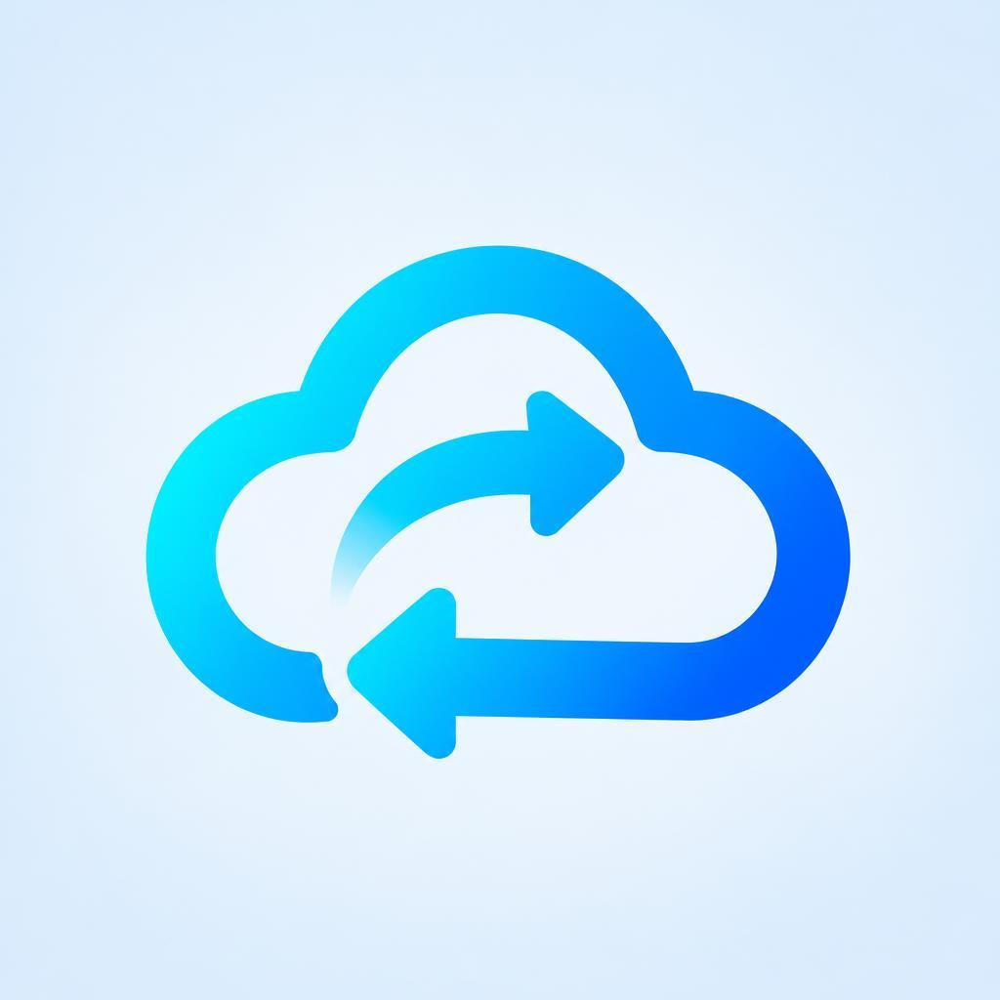
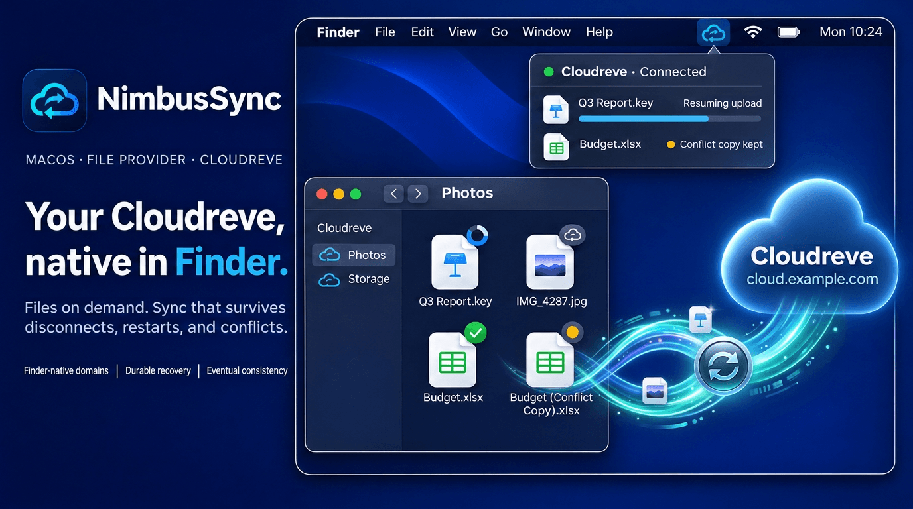
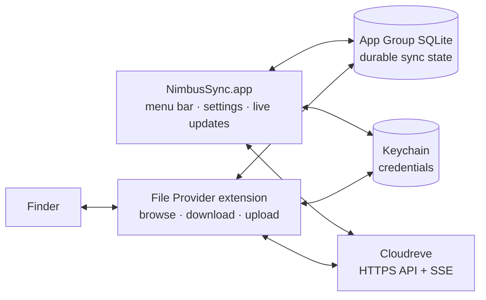

<div align="center">

<picture>
  <source media="(prefers-color-scheme: dark)" srcset="Design/AppIcon-Dark.png">
  
</picture>

# NimbusSync

**Your self-hosted Cloudreve, native in Finder.**

[](#requirements)
[](Package.swift)
[](#requirements)
[](LICENSE)

**English** | [简体中文](README.zh-CN.md)



</div>

NimbusSync is a menu-bar app for macOS that puts your
[Cloudreve](https://github.com/cloudreve/cloudreve) server in the Finder
sidebar. Built on Apple's File Provider framework, it shows the remote
folder tree right away and downloads a file only when you open it. Edits
upload in the background.

> [!IMPORTANT]
> **Technical Preview.** There is no signed or notarized release yet, so you
> have to build NimbusSync from source. The local test suite passes, but
> behaviour against real Cloudreve servers, the full Finder flow when signed,
> and notarization still need validation. Don't rely on it as the only copy
> of important data.

## Highlights

- **A real Finder location.** Each Cloudreve folder you add appears in the
  Finder sidebar. Files download on demand, and the system can free up their
  local copies when it needs space.
- **Survives disconnects and restarts.** Pending uploads, renames and deletes
  are saved to disk. They pick up where they stopped after a crash, a reboot
  or lost network, and uploads resume from their saved upload session.
- **Never silently overwrites your edits.** If a file changed on the server
  while you were editing it, your version is kept next to it as a conflict
  copy.
- **Live, but careful.** The server's live updates (SSE) bring remote changes
  to Finder quickly. A full check runs only when it's actually needed:
  missed events, a schedule, or a manual request. If a check is interrupted,
  it resumes where it stopped.
- **Safe by design.** Sign-in uses your browser (OAuth with PKCE), tokens
  stay in the Keychain, connections are HTTPS-only, and logs never record
  tokens, signed URLs or file contents.
- **One glance from the menu bar.** The menu-bar icon shows whether you're
  up to date, syncing, offline or need to act. Click it to see recent tasks,
  progress and issues you can retry or clear.

## Requirements

- macOS 13 Ventura or later
- Xcode with Swift 6 to build, plus [ripgrep](https://github.com/BurntSushi/ripgrep)
  (`rg`), which the build script uses for its pre-build scans
- A Cloudreve **4.12 or later** server reachable over **HTTPS**
- An Apple Developer team to sign the build: macOS only loads File Provider
  extensions from signed apps

## Getting Started

### 1. Build and launch

```sh
git clone https://github.com/jorben/NimbusSync.git
cd NimbusSync
cp Config/build.local.sh.example Config/build.local.sh   # fill in your signing settings
make dev
```

`make dev` builds through [`Scripts/build.sh`](Scripts/build.sh), places the app
in `Dist/NimbusSync.app` and relaunches it. Without signing settings you get
an unsigned build. The app runs, but Finder reports the extension as
unavailable. For signing details, see [Signed builds](#signed-builds).

> [!TIP]
> Just working on the UI? `make dev-unsigned` is a faster Debug build that
> skips signing and the pre-build scans.

### 2. Add your Cloudreve server

1. Click the NimbusSync icon in the menu bar and choose **Add Domain**.
2. Enter your Cloudreve address (for example `https://cloud.example.com`).
3. Sign in through the browser window that opens, then give the domain a name.

The new domain appears under **Locations** in the Finder sidebar. Manage it
later from **Settings → Domains**: rename, reauthorize, run a full check,
edit exclusions or remove it. Removing a domain never deletes anything on the
server.

## How It Works



The app and the Finder extension don't call each other. They share state
through an App Group SQLite database, so Finder keeps working even when the
menu-bar app isn't running. Remote events are written to the store before
Finder is told to refresh, and every local change becomes a durable operation
before it touches the server. For the invariants behind this design, see the
[technical architecture](docs/02-macos-technical-architecture.md).

## Development

| Command | What it does |
| --- | --- |
| `make dev` | Build (signed if configured), then relaunch the app |
| `make dev-unsigned` | Fast unsigned Debug build for UI work |
| `make build` | Full build with secret/entitlement scans and `Dist/` zip + checksum |
| `make test` | Run the Swift package tests (`swift test --disable-sandbox`) |
| `make lint` | `git diff --check` |
| `make clean` | Remove `.build/` and `Dist/` |

Run `make` with no target to list them all. Focus on one test suite with
`make test-swift SWIFT_TEST_FLAGS='--filter ActivityLogTests'`.

<details>
<summary id="signed-builds"><strong>Signed builds</strong></summary>

Import your certificate into the login keychain, install the three
provisioning profiles (app, File Provider, File Provider UI), then set these
in `Config/build.local.sh` (Git ignores this file) or pass them as
environment variables:

| Variable | Meaning |
| --- | --- |
| `NIMBUSSYNC_SIGNING_MODE` | `signed` (default: `unsigned`) |
| `NIMBUSSYNC_CONFIGURATION` | `Debug` or `Release` (default: `Debug`) |
| `NIMBUSSYNC_DEVELOPMENT_TEAM` | Apple Developer Team ID |
| `NIMBUSSYNC_CODE_SIGN_IDENTITY` | Signing identity name in your keychain |
| `NIMBUSSYNC_APP_PROFILE` | App provisioning profile UUID |
| `NIMBUSSYNC_FILE_PROVIDER_PROFILE` | File Provider profile UUID |
| `NIMBUSSYNC_FILE_PROVIDER_UI_PROFILE` | File Provider UI profile UUID |
| `NIMBUSSYNC_APP_GROUP_IDENTIFIER` | App Group (default: `group.ai.tiy.nimbussync`) |

The unprefixed names (`SIGNING_MODE`, `CONFIGURATION`, `DEVELOPMENT_TEAM`, …)
also work on the command line, as do `BUILD_ROOT`, `DIST_DIR` and `VERSION`:

```sh
make build CONFIGURATION=Release SIGNING_MODE=signed
```

The build fails closed if the secret scan finds a hit or if a Release build
contains the File Provider testing-mode entitlement or an insecure transport
exception.

</details>

<details>
<summary><strong>Repository layout</strong></summary>

```text
Apps/NimbusSync/          Menu-bar app, Settings and app lifecycle
Extensions/               Replicated File Provider + File Provider UI extensions
Packages/                 Shared Swift modules
  NimbusSyncAuthKit/        OAuth/PKCE, Keychain, token refresh
  NimbusSyncDomainKit/      Domain identity, health, capabilities
  NimbusSyncDomainService/  Add, rename and safely remove domains
  NimbusSyncStoreBridge/    App Group SQLite and durable state
  NimbusSyncEventCoordinator/  SSE, reconciliation, full checks
  NimbusSyncFileProviderKit/   Enumeration, downloads, mutations, replay
  NimbusSyncProductKit/     Tasks, conflicts and UI state
  NimbusSyncDesignSystem/   Menu-bar panel, Settings and design tokens
  NimbusSyncObservability/  Shared activity log and redacted diagnostics
Tests/                    Swift unit tests and the golden SQLite schema
Scripts/                  Build, release-manifest and icon scripts
docs/                     Product requirements, architecture, phase plans
```

</details>

## Documentation

The design documents in [`docs/`](docs/) are currently written in Chinese.

- [Product requirements](docs/01-macos-product-requirements.md): scope and
  acceptance scenarios
- [Technical architecture](docs/02-macos-technical-architecture.md): process
  model, state and invariants
- [File Provider parity design](docs/08-file-provider-nextcloud-parity-implementation.md)
- [Phase reports](docs/archive/reports/): what has been verified so far

## Contributing

Issues and pull requests are welcome. Before you open a PR, read
[`AGENTS.md`](AGENTS.md) for the repository conventions, add focused tests for
the behaviour you change, and run `make test` and `make lint`. Commits follow
Conventional Commits with gitmoji, such as `fix: 🐛 ...`. Never commit
credentials, signed URLs or server response bodies.

## License

NimbusSync is licensed under the [Apache License 2.0](LICENSE). Cloudreve is a
separate project with its own license.
