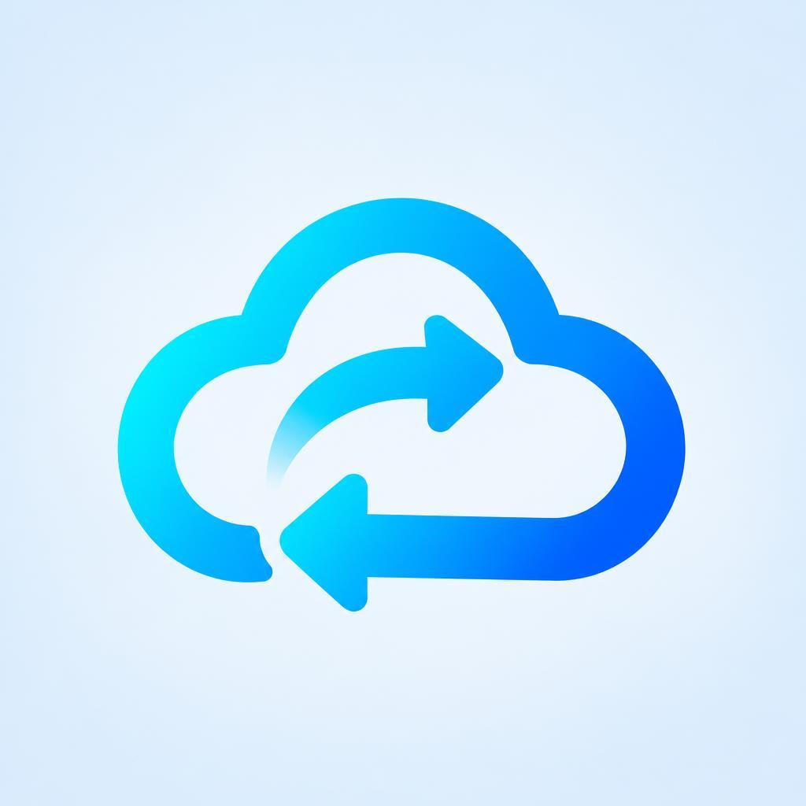
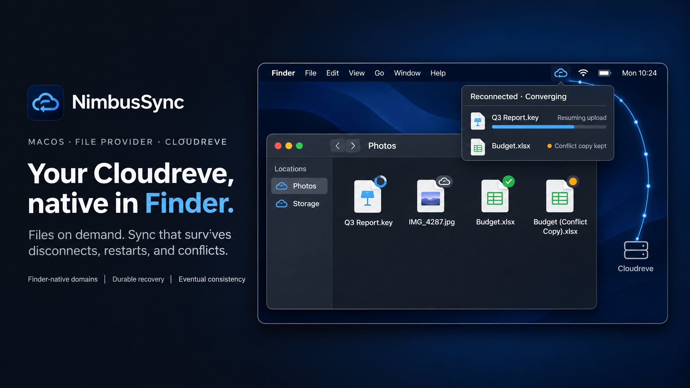
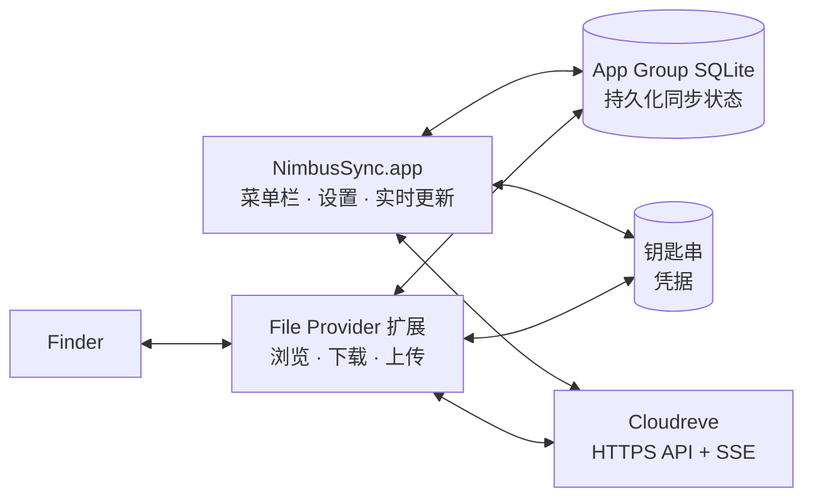

<div align="center">

<picture>
  <source media="(prefers-color-scheme: dark)" srcset="Design/AppIcon-Dark.png">
  
</picture>

# NimbusSync

**把自托管的 Cloudreve 原生接入 Finder。**

[](#环境要求)
[](Package.swift)
[](#环境要求)
[](LICENSE)

[English](README.md) | **简体中文**



</div>

NimbusSync 是一款 macOS 菜单栏应用，它把你的
[Cloudreve](https://github.com/cloudreve/cloudreve) 服务器放进 Finder 侧边栏。
它基于 Apple 的 File Provider 框架：远端目录树可以立即浏览，文件在打开时才下载，
本地修改在后台上传回服务器。

> [!IMPORTANT]
> **Technical Preview（技术预览）。** 目前还没有签名、公证过的发布版，需要从源码
> 构建。本地测试套件已全部通过，但对接真实 Cloudreve 服务器的行为、签名后的
> Finder 完整流程以及公证仍待验证。请不要把它作为重要数据的唯一副本。

## 亮点

- **真正的 Finder 位置。** 每个添加的 Cloudreve 目录都会出现在 Finder 侧边栏中，
  文件按需下载，系统空间不足时可以释放本地副本。
- **断网、重启都不怕。** 待上传、重命名、删除等操作都会持久化到磁盘，崩溃、重启或
  断网后从中断处继续；上传会从已保存的上传会话续传。
- **绝不悄悄覆盖你的修改。** 如果你编辑期间服务器上的文件也变了，你的版本会作为
  冲突副本保存在原文件旁边。
- **实时，但谨慎。** 服务器的实时推送（SSE）让远端变更很快出现在 Finder 中；
  只有在确有需要时才运行全量检查：错过了事件、到了计划时间，或者你手动触发。
  检查中断后会从中断位置继续。
- **安全为先。** 通过浏览器登录（OAuth + PKCE），令牌只存放在钥匙串中，连接仅限
  HTTPS，日志不会记录令牌、签名 URL 或文件内容。
- **菜单栏一眼可知。** 菜单栏图标显示已同步、同步中、离线或需要处理；点开即可
  查看最近任务、进度，以及可重试或清除的问题。

## 环境要求

- macOS 13 Ventura 或更高版本
- 构建需要支持 Swift 6 的 Xcode，以及构建脚本做预检扫描时用到的
  [ripgrep](https://github.com/BurntSushi/ripgrep)（`rg`）
- 可通过 **HTTPS** 访问的 Cloudreve **4.12 或更高版本**服务器
- 用于签名构建的 Apple Developer 团队：macOS 只会加载已签名应用中的
  File Provider 扩展

## 快速开始

### 1. 构建并启动

```sh
git clone https://github.com/jorben/NimbusSync.git
cd NimbusSync
cp Config/build.local.sh.example Config/build.local.sh   # 填写你的签名配置
make dev
```

`make dev` 通过 [`Scripts/build.sh`](Scripts/build.sh) 构建，把应用放到
`Dist/NimbusSync.app` 并重新启动。如果没有签名配置，得到的是未签名构建：应用能
运行，但 Finder 会提示扩展不可用。签名细节见[签名构建](#signed-builds)。

> [!TIP]
> 只改 UI？`make dev-unsigned` 是更快的 Debug 构建，会跳过签名和预检扫描。

### 2. 添加 Cloudreve 服务器

1. 点击菜单栏中的 NimbusSync 图标，选择 **Add Domain**。
2. 输入 Cloudreve 地址（例如 `https://cloud.example.com`）。
3. 在弹出的浏览器窗口中登录，然后为这个 Domain 命名。

新的 Domain 会出现在 Finder 侧边栏的 **位置** 下。之后可以在
**Settings → Domains** 中管理：重命名、重新授权、运行全量检查、编辑排除项或移除。
移除 Domain 永远不会删除服务器上的任何内容。

> [!NOTE]
> 应用界面目前仅提供英文。

## 工作原理



应用和 Finder 扩展之间不直接互相调用，而是通过 App Group 中的 SQLite 数据库共享
状态，所以即使菜单栏应用没有运行，Finder 也能正常工作。远端事件会先写入存储，再
通知 Finder 刷新；每个本地修改在发往服务器之前，都会先成为一条持久化操作。这一设计
背后的不变量见[技术架构](docs/02-macos-technical-architecture.md)。

## 开发

| 命令 | 作用 |
| --- | --- |
| `make dev` | 构建（如已配置则签名）并重新启动应用 |
| `make dev-unsigned` | 用于 UI 开发的快速未签名 Debug 构建 |
| `make build` | 完整构建：密钥/entitlement 扫描，产出 `Dist/` 下的 zip 和校验和 |
| `make test` | 运行 Swift Package 测试（`swift test --disable-sandbox`） |
| `make lint` | `git diff --check` |
| `make clean` | 删除 `.build/` 和 `Dist/` |

不带参数运行 `make` 可列出全部目标。只跑某一组测试：
`make test-swift SWIFT_TEST_FLAGS='--filter ActivityLogTests'`。

<details>
<summary id="signed-builds"><strong>签名构建</strong></summary>

把证书导入登录钥匙串，安装三个描述文件（应用、File Provider、File Provider UI），
然后在 `Config/build.local.sh`（已被 Git 忽略）中设置下列变量，或通过环境变量传入：

| 变量 | 含义 |
| --- | --- |
| `NIMBUSSYNC_SIGNING_MODE` | `signed`（默认 `unsigned`） |
| `NIMBUSSYNC_CONFIGURATION` | `Debug` 或 `Release`（默认 `Debug`） |
| `NIMBUSSYNC_DEVELOPMENT_TEAM` | Apple Developer Team ID |
| `NIMBUSSYNC_CODE_SIGN_IDENTITY` | 钥匙串中的签名身份名称 |
| `NIMBUSSYNC_APP_PROFILE` | 应用描述文件 UUID |
| `NIMBUSSYNC_FILE_PROVIDER_PROFILE` | File Provider 描述文件 UUID |
| `NIMBUSSYNC_FILE_PROVIDER_UI_PROFILE` | File Provider UI 描述文件 UUID |
| `NIMBUSSYNC_DEBUG_*` / `NIMBUSSYNC_RELEASE_*` | 按配置覆盖上面的签名身份和三个描述文件，例如 `NIMBUSSYNC_DEBUG_APP_PROFILE` |

Debug 与 Release 使用两套独立身份，可以同时装在一台 Mac 上：

| | Release | Debug（Dev） |
| --- | --- | --- |
| 应用 | `io.github.jorben.nimbussync` | `io.github.jorben.nimbussync.dev` |
| 扩展 | `….nimbussync.fileprovider` / `.fileproviderui` | `….nimbussync.dev.fileprovider` / `.fileproviderui` |
| App Group | `group.io.github.jorben.nimbussync` | `group.io.github.jorben.nimbussync.dev` |
| Keychain 组 | `TEAMID.io.github.jorben.nimbussync` | `TEAMID.io.github.jorben.nimbussync.dev` |
| 名称 / 深链 | NimbusSync / `nimbussync://` | NimbusSyncDev / `nimbussync-dev://` |

两套身份各自需要 App ID、App Group 和描述文件（Dev 的 File Provider 还需要
File Provider Testing Mode）。两个构建产物都叫 `NimbusSync.app`，Dev 版请直接从
`Dist/` 运行，不要放进 `/Applications`。两者都注册了服务端规定的 `cloudreve://`
OAuth 回调，macOS 只会交给其中一个：登录或重新授权前请先退出另一个版本。

命令行中也可以使用不带前缀的名称（`SIGNING_MODE`、`CONFIGURATION`、
`DEVELOPMENT_TEAM` 等），以及 `BUILD_ROOT`、`DIST_DIR` 和 `VERSION`：

```sh
make build CONFIGURATION=Release SIGNING_MODE=signed
```

以下情况构建会直接失败：密钥扫描有命中，或 Release 构建中带有 File Provider
测试模式 entitlement 或不安全的传输例外。

</details>

<details>
<summary><strong>目录结构</strong></summary>

```text
Apps/NimbusSync/          菜单栏应用、设置窗口与应用生命周期
Extensions/               Replicated File Provider 与 File Provider UI 扩展
Packages/                 共享 Swift 模块
  NimbusSyncAuthKit/        OAuth/PKCE、钥匙串、令牌刷新
  NimbusSyncDomainKit/      Domain 标识、健康状态、能力
  NimbusSyncDomainService/  添加、重命名与安全移除 Domain
  NimbusSyncStoreBridge/    App Group SQLite 与持久化状态
  NimbusSyncEventCoordinator/  SSE、对账、全量检查
  NimbusSyncFileProviderKit/   枚举、下载、变更与重放
  NimbusSyncProductKit/     任务、冲突与 UI 状态
  NimbusSyncDesignSystem/   菜单栏面板、设置界面与设计 token
  NimbusSyncObservability/  共享活动日志与脱敏诊断
Tests/                    Swift 单元测试与 SQLite schema 基准快照
Scripts/                  构建、发布清单与图标脚本
docs/                     产品需求、技术架构、阶段计划
```

</details>

## 文档

- [产品需求](docs/01-macos-product-requirements.md)：范围与验收场景
- [技术架构](docs/02-macos-technical-architecture.md)：进程模型、状态与不变量
- [File Provider 对齐设计](docs/08-file-provider-nextcloud-parity-implementation.md)
- [阶段报告](docs/archive/reports/)：目前已验证的内容

## 参与贡献

欢迎提交 Issue 和 Pull Request。提交 PR 前，请先阅读 [`AGENTS.md`](AGENTS.md)
了解仓库约定，为改动的行为补充针对性测试，并运行 `make test` 和 `make lint`。
提交信息遵循带 gitmoji 的 Conventional Commits，例如 `fix: 🐛 ...`。请勿提交
凭据、签名 URL 或服务器响应内容。

## 许可证

NimbusSync 基于 [Apache License 2.0](LICENSE) 授权。Cloudreve 是独立项目，
遵循其自身的许可证。
