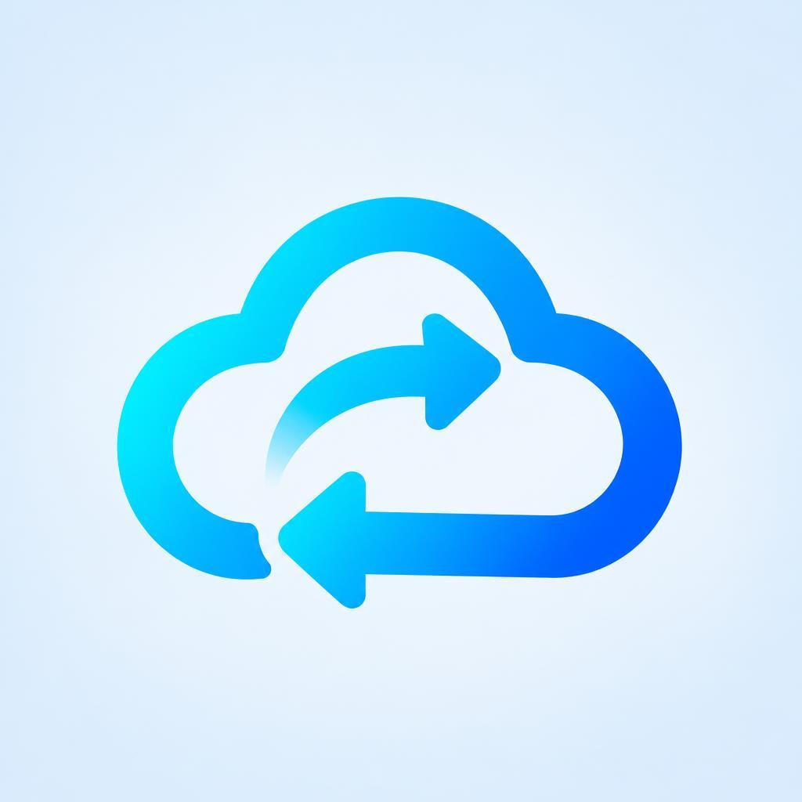
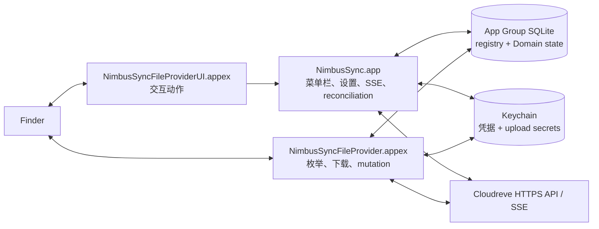

<div align="center">

<picture>
  <source media="(prefers-color-scheme: dark)" srcset="Design/AppIcon-Dark.png">
  
</picture>

# NimbusSync

**面向自托管 Cloudreve 实例的原生 macOS File Provider 客户端。**

[](#环境要求)
[](#架构)
[](#环境要求)
[](LICENSE)

[English](README.md) | 简体中文

</div>

NimbusSync 将 macOS 菜单栏应用、Replicated File Provider 扩展和自托管
Cloudreve 服务端连接起来。每个配置的远端根目录都会映射为 Finder 侧边栏中的一个
File Provider Domain，Finder 可以浏览远端 metadata、按需下载文件内容；客户端
同时把恢复、事件一致性和诊断所需的状态持久化在本地。

> [!IMPORTANT]
> 这是一个以源码构建为主的 Technical Preview/Beta 工程仓库，不是 1.0
> 发布版，也不是已经发布到注册表的 Swift 包。本地 Swift、Xcode
> 以及静态安全/Release 门禁已经建立，但真实 Cloudreve mutation 语义、签名
> Finder 端到端行为、Provider 上传矩阵、公证和长稳证据仍未验证。当前 Phase 4
> 的 1.0 发布结论是 **No-Go**。

> [!NOTE]
> 完整的产品需求和架构材料位于 `docs/`，目前以中文为主。英文版和本中文版
> README 保持同一结构和事实口径，但不会把深层设计文档全部重复到首页。

## 当前状态

以下状态依据阶段退出报告（2026-08-25）、Phase 5 File Provider 对齐实施报告
（2026-09-05）和当前源码整理，并明确区分本地工程证据与真实外部平台证据：

| 范围 | 当前状态 | 证据或边界 |
| --- | --- | --- |
| Swift Store/Auth/File Provider/Event/Product 模块 | 本地已验证 | Swift Package 测试及 Xcode Debug 构建 |
| 菜单栏 App、Settings 窗口和扩展 Target | 本地已实现 | `NimbusSync`、`NimbusSyncFileProvider`、`NimbusSyncFileProviderUI` |
| File Provider 对齐工作（FP-001 至 FP-012） | 本地已实现 | 见 [`phase-5-nextcloud-parity-implementation.md`](docs/archive/reports/phase-5-nextcloud-parity-implementation.md)；签名 Finder 证据仍待补齐 |
| 真实 Cloudreve root/item identity 与条件写 | 未验证 | 需要受控的 Cloudreve contract 环境 |
| Provider 上传完成与断点恢复矩阵 | 未验证 | 已按 Cloudreve v4 基线开放，仍需真实服务端矩阵验证 |
| 签名 Finder callback replay 与 File Provider E2E | 未验证 | 需要签名扩展和真实 Finder 证据 |
| Developer ID、公证、Gatekeeper、干净机器升级 | 未验证 | 需要发布凭据和测试机器 |
| 1.0 Release Candidate | No-Go | 见 [`phase-4-release-readiness.md`](docs/archive/reports/phase-4-release-readiness.md) |

每个 Domain 仍保存 `verified` / `unsupported` / `unverified` 三态 capability
snapshot。新建 Domain 直接使用文档化的 Cloudreve v4 基线
（`CapabilitySnapshot.cloudreveV4`）；旧版本持久化的"全默认、从未探测"快照会在
读取时自动升级。存储策略按每次上传会话实际返回的类型校验，因此不同目录使用不同
Cloudreve 存储策略时都可以写入。添加 Domain 要求服务端为 Cloudreve 4.12 或更高
版本且可通过 HTTPS 访问；更旧的服务端会在添加时被拒绝。

## 为什么做 NimbusSync

macOS 云文件是系统集成问题，而不只是一个 HTTP 客户端。NimbusSync 围绕
Finder 边界上最容易造成数据损坏的故障设计：

- **Finder 原生 Domain**：使用 `NSFileProviderReplicatedExtension`，不把远端
  文件树伪装成一个由普通 watcher 驱动的本地目录。
- **可恢复的 callback**：operation replay key、lease、source fingerprint、
  upload checkpoint 和 conflict summary 都进入持久状态，不依赖游离内存任务；
  replay key 能区分同一 item 的多次重命名和移动。
- **显式一致性链路**：Cloudreve SSE 只作为变化提示。客户端用同一 client ID
  重连，让服务端补发离线期间保留的事件；metadata enrichment、本地 change
  journal、signal outbox 和 reconciliation 共同构成最终收敛路径。
- **只在必要时全量检查**：全量检查要列出每个目录，因此只在服务端没有为该客户端
  保留事件、Domain 从未完成过全量检查、到达后台周期（每天、每 7 天或每 30 天）
  或用户手动触发时运行；中断的检查会从保存的位置续扫。
- **稳定且不透明的 identity**：本地 Domain/item identifier 不暴露 origin、账号、
  远端路径或文件名；远端对象身份也不会仅由路径推断，按路径删除或移入回收站前
  会先校验远端对象身份。
- **可恢复的写入**：不完整扫描不会生成 tombstone；临时失败的写入保持可重放
  （上传从持久化的 upload session 续传），基于过期版本的编辑会保存为同目录的
  冲突副本，而不是让该文件永久卡住。

## 当前已经具备的内容

当前 checkout 已包含以下基础能力和产品入口：

### Swift macOS 产品层

- **菜单栏面板**（AppKit 状态栏项承载 SwiftUI）：同步状态图标（已同步、同步中
  带箭头动画、离线时暂停、需要处理）、与悬停提示一致的状态摘要、已连接 Domain
  （Open in Finder、Check Now）、全量检查进度、按天分组的近期任务，以及可单条或
  一次性全部重试/清除的问题列表。
- **Add Domain 窗口**：输入 Cloudreve 4.12+ 的 HTTPS 地址，通过浏览器登录
  （OAuth/PKCE），并为 Domain 命名。
- **Settings 窗口**，共四页（⌘1–⌘4）：
  - *Domains*：Finder 集成状态；每个 Domain 支持重命名、Open in Finder、
    Open Cloudreve、Reauthorize、Full check now、Edit Exclusions 和移除。
  - *General*：主题（System/Light/Dark）、登录时启动、Dock 图标开关、后台全量
    检查周期，以及通知（总开关加"需要重新授权""冲突""永久失败"三个子开关）。
  - *Diagnostics*：App 与 Finder 扩展的最近日志、两者共享的日志级别
    （Debug/Info/Warning/Error）、复制和在 Finder 中显示。
  - *About*：版本、许可证和源码仓库。
- 冲突窗口、通知、deep link 路由和登录启动基础能力。Dock 图标可选；显示时点击
  Dock 图标会切换菜单栏面板。
- Replicated File Provider 扩展：item 映射、分页枚举、change enumeration、
  内容获取、mutation、custom action 和 Domain state projection。
- File Provider UI 扩展：校验不透明 item identifier，并将支持的交互动作路由回
  主应用；不持有凭据，也不持有持久 mutation 状态。
- Swift 共享模块：Domain 生命周期与服务、OAuth/PKCE/Keychain、App Group SQLite、
  事件协调、File Provider adapter、产品 projection、observability 和 design system。

目前界面仅提供英文。

### 协议、状态与恢复基础

- Cloudreve origin 规范化、服务端版本校验、API envelope、文件 metadata DTO、分页、
  content/metadata version hash、Provider capability snapshot 和严格 SSE framing。
- Registry 与每个 Domain 的 SQLite 状态：WAL、foreign key、schema fence、migration
  hook、quick check、backup、repair isolation、directory snapshot、sync anchor、
  change journal、signal outbox、operation、conflict、exclusion intent 和 upload checkpoint。
- OAuth callback 校验、PKCE state、Keychain 凭据存储、App Group advisory refresh
  lock、有界 secret 存储，以及不跨 origin 转发 Bearer 的 redirect policy。
- create、modify、trash、restore、delete 的持久 mutation/replay 基础，包含 stale
  version rejection、source fingerprint、取消和冲突解决 service。生产写入仍受
  capability gate 控制，真实服务端契约尚未验证。
- SSE supervisor/reconnect、事件 scope guard、metadata enrichment、本地写回声匹配、
  working-set signal、outbox drain、generation reconciliation、stable-root 检查、
  health reducer 和 scheduler 模型。
- 可续扫的全量检查：运行中持续保存续扫位置；超过 5 分钟未刷新存活信号的检查会被
  标记为失败并保留 cursor；同一 Domain 同时只运行一次检查。
- 跨进程 activity log，日志级别通过 App Group 共享，App 与 Finder 扩展无需重启即
  遵循同一设置。

产品是纯 Swift 实现：Xcode project 直接链接 Swift Package products，不再包含
Rust workspace 或 native FFI 产物。

## 架构



最重要的状态交付链路是：

```text
远端事件或 reconciliation
  -> metadata enrichment 与 scope 校验
  -> SQLite item + journal + signal outbox 事务
  -> .workingSet signal
  -> File Provider change enumeration
```

本地 mutation 会先关联持久 operation 和 replay key。执行前检查 item/version，
只有 capability snapshot 允许时才访问写路径；最终 outcome 持久化后再返回给
File Provider。匹配的 SSE echo 只负责确认，不再次生成 provider-visible change。
主应用不是 Extension callback 必须依赖的 RPC 代理。

## 安全与数据边界

- OAuth access/refresh credential 与上传相关不透明 secret 只进入 Keychain；SQLite
  只保存引用和恢复所需的非敏感 metadata。
- App 与 File Provider 进程通过 App Group 和 SQLite 共享持久事实。Darwin notification
  只是唤醒提示，不是第二个状态存储。
- Release 配置只允许 HTTPS；Debug 可在显式开启时为受控测试使用 loopback HTTP。
- Bearer 不跨 origin 转发，也不发送到 signed storage URL。SSE payload、token、signed
  URL、文件内容和敏感路径不进入普通诊断。
- File Provider callback 不依赖主应用、旧 callback URL、旧 FD 或 callback 结束后仍未
  持久化的 detached task。
- Domain 移除在状态不确定时保留 dirty data，且不调用远端 Cloudreve delete API。排除
  cleanup 使用精确持久 intent，与用户主动删除保持独立。
- reconciliation 可以增量发布新增和更新，但只有完整且稳定的扫描才能提交破坏性
  tombstone；已 tombstone 的 item 不再返回给系统。

## 环境要求

### 工具链

- macOS 13 或更高版本，依据 [`Package.swift`](Package.swift) 和 Xcode deployment settings。
- 支持 Swift 6 的 Xcode。本 checkout 当前在 Xcode 27.2、Swift 6.4.2 环境检查过；项目
  声明 Swift 6.0，但没有在仓库中锁定 Xcode 发行版。
- [ripgrep](https://github.com/BurntSushi/ripgrep)（`rg`），`Scripts/build.sh` 的
  构建前扫描依赖它。
- 添加 Domain 需要 Cloudreve 4.12 或更高版本且使用 HTTPS 的服务端。本地单元测试
  不需要真实 Cloudreve；任何真实服务端/Provider 支持结论都需要受控 Cloudreve 实例
  和单独的外部验证。
- File Provider E2E 需要签名开发环境和真实 Finder 测试机；未签名构建只能用于验证
  编译和 UI。

### Clone

```sh
git clone git@github.com:tiylabs/nimbussync.git
cd nimbussync
```

如果 GitHub remote 需要权限，请使用仓库既有的认证方式。

## 构建

### Make 目标

[`Makefile`](Makefile) 封装了常用任务，直接运行 `make` 可列出全部目标：

| 目标 | 用途 |
| --- | --- |
| `make dev` | 通过 `Scripts/build.sh` 构建（本地配置要求时签名）并重新启动 App |
| `make dev-unsigned` | 快速未签名 Debug 构建，用于 UI 开发；File Provider 扩展不会加载 |
| `make build` | 统一构建，含扫描并产出 `Dist/` 制品 |
| `make test` | Swift Package 测试（可用 `SWIFT_TEST_FLAGS` 传入额外参数） |
| `make lint` | `git diff --check` |
| `make clean` | 删除 `.build/` 和 `Dist/` |

`CONFIGURATION` 与 `SIGNING_MODE` 只在显式设置时才会转发，例如
`make build CONFIGURATION=Release SIGNING_MODE=signed`。

### 构建脚本

唯一的构建入口是 [`Scripts/build.sh`](Scripts/build.sh)。它可选读取机器本地的
`Config/build.local.sh`（可复制 [`Config/build.local.sh.example`](Config/build.local.sh.example)
创建），构建前先执行以下 fail-closed 检查：

- 仓库 secret 扫描，以及针对 File Provider testing-mode entitlement 和不安全传输例外
  的 Release 扫描；
- 对 `Artifacts/` 的制品扫描，防止输出类似凭据的内容；
- 设置 `NIMBUSSYNC_EXTERNAL_EVIDENCE` 时校验脱敏的外部证据报告
  （`NIMBUSSYNC_REQUIRE_GO=1` 时要求结论为 Go）；
- `git diff --check`。

随后重新生成包含两个 Extension 的 App bundle，校验签名（签名 Release 构建还会检查
hardened runtime），并把 App、zip 和 checksum 写入 `Dist/`。

```sh
Scripts/build.sh
```

默认输出为：

```text
.build/ci/derived/Build/Products/$CONFIGURATION/NimbusSync.app
Dist/NimbusSync.app
Dist/NimbusSync-0.1.0.zip
Dist/NimbusSync-0.1.0.zip.sha256
```

如需指定输出目录和版本：

```sh
CONFIGURATION=Debug \
SIGNING_MODE=unsigned \
BUILD_ROOT="$PWD/.build/debug" \
DIST_DIR="$PWD/Dist/debug" \
VERSION=dev \
Scripts/build.sh
```

如果执行签名构建，必须先把证书私钥导入当前用户的 keychain，并通过 Xcode 或系统方式
安装三个 provisioning profile，然后提供以下变量（也可以在 `Config/build.local.sh`
中使用对应的 `NIMBUSSYNC_*` 变量，见示例文件）：

| 变量 | 必需 | 说明 |
| --- | --- | --- |
| `SIGNING_MODE` | 是 | 设置为 `signed` |
| `CONFIGURATION` | 否 | 通常使用 `Release`，默认 `Debug` |
| `DEVELOPMENT_TEAM` | 是 | Apple Developer Team ID |
| `CODE_SIGN_IDENTITY` | 是 | 当前 keychain 中的完整签名身份名称 |
| `NIMBUSSYNC_APP_PROFILE` | 是 | App profile UUID |
| `NIMBUSSYNC_FILE_PROVIDER_PROFILE` | 是 | File Provider profile UUID |
| `NIMBUSSYNC_FILE_PROVIDER_UI_PROFILE` | 是 | File Provider UI profile UUID |
| `APP_GROUP_IDENTIFIER` | 否 | 默认 `group.ai.tiy.nimbussync` |
| `BUILD_ROOT`/`DIST_DIR`/`VERSION` | 否 | 构建目录、输出目录和 artifact 版本 |

构建入口不会替你导入证书或 profile。本地构建配置已加入 Git 忽略规则，因此证书名称、
profile UUID 和其他机器专用签名设置不会被提交。需要实际注册 File Provider Domain 时
必须使用 Apple Development 签名，未签名构建只能验证编译和 UI。

### 测试与辅助脚本

```sh
# Swift Package tests
swift test --disable-sandbox

# 空白检查
git diff --check

# 本地 Store 基准测试（仅使用临时 SQLite，不访问网络或 Keychain）
Scripts/run-local-benchmarks.sh
```

[`Scripts/validate-phase-5-evidence.sh`](Scripts/validate-phase-5-evidence.sh)
校验脱敏的外部验收报告，且不会把缺失的 Apple/Cloudreve 环境误判为通过；
[`Scripts/generate-release-manifest.sh`](Scripts/generate-release-manifest.sh)
为构建好的压缩包生成 manifest。其余 `make-*` 脚本用于重新生成 App、Domain 和菜单栏图标。

仓库目前没有 GitHub Actions workflow；旧的分阶段门禁脚本暂不恢复，待产品流程和
发布证据完成后再引入。

## 仓库结构

```text
Apps/NimbusSync/                   SwiftUI/AppKit 菜单栏 App、Settings 和生命周期
Extensions/NimbusSyncFileProvider/ Replicated File Provider 入口
Extensions/NimbusSyncFileProviderUI/交互式 File Provider action
Packages/                           共享 Swift 模块
  NimbusSyncDomainKit/              Domain identity、lifecycle、health、scope、capability
  NimbusSyncDomainService/          Domain 创建、身份校验、重命名、安全移除
  NimbusSyncAuthKit/                OAuth、PKCE、Keychain、refresh 协调
  NimbusSyncStoreBridge/            App Group SQLite 和持久状态
  CSQLite/                          系统 SQLite module map
  NimbusSyncEventCoordinator/       SSE、journal 交付、reconciliation、全量检查
  NimbusSyncFileProviderKit/        Finder item、枚举、内容、mutation
  NimbusSyncProductKit/             产品 projection、任务、冲突、UI state
  NimbusSyncDesignSystem/           Design token、菜单栏面板、Settings 组件
  NimbusSyncObservability/          脱敏诊断、activity log 和 metrics
Config/                             Entitlement、Info.plist、Debug/Release 设置
Design/                             App 图标与菜单栏图标源图
Scripts/build.sh                    构建前检查、App 构建和打包
Scripts/NimbusSyncBenchmarks/       本地 Store 基准测试可执行程序
Makefile                            开发任务入口
Tests/SwiftUnitTests/               Swift unit/invariant tests
Tests/FileProviderUnitTests/        File Provider 与线协议测试
Tests/schema-manifest.json          SQLite schema 黄金快照
docs/                               产品、架构、阶段计划、退出报告
```

Swift Package product 以 `Cloudreve*` 命名（例如 `CloudreveDomainKit`），源码目录
则使用 `NimbusSync*` 前缀。更深层的阶段计划中有一些尚未出现在当前 checkout 的未来
Target 或 crate。上面的结构严格依据当前文件整理，而不是把规划中的架构图当成已存在
的目录。

## 文档导航

按任务选择入口：

| 主题 | 文档 |
| --- | --- |
| 调研与 macOS 平台映射 | [`docs/00-macos-port-research.md`](docs/00-macos-port-research.md) |
| 产品需求与验收场景 | [`docs/01-macos-product-requirements.md`](docs/01-macos-product-requirements.md) |
| 技术架构与不变量 | [`docs/02-macos-technical-architecture.md`](docs/02-macos-technical-architecture.md) |
| Phase 0 协议/File Provider Spike | [`docs/03-phase-0-protocol-file-provider-spike.md`](docs/03-phase-0-protocol-file-provider-spike.md) |
| Phase 1 持久化与读路径 | [`docs/04-phase-1-persistence-read-path.md`](docs/04-phase-1-persistence-read-path.md) |
| Phase 2 写路径与上传恢复 | [`docs/05-phase-2-write-path-upload-recovery.md`](docs/05-phase-2-write-path-upload-recovery.md) |
| Phase 3 SSE 与一致性 | [`docs/06-phase-3-events-consistency.md`](docs/06-phase-3-events-consistency.md) |
| Phase 4 产品化与发布 | [`docs/07-phase-4-product-release.md`](docs/07-phase-4-product-release.md) |
| File Provider 对齐设计（FP-001 至 FP-012） | [`docs/08-file-provider-nextcloud-parity-implementation.md`](docs/08-file-provider-nextcloud-parity-implementation.md) |
| 阶段退出与对齐证据 | [`docs/archive/reports/`](docs/archive/reports/) |
| 仓库约定与安全规则 | [`AGENTS.md`](AGENTS.md) |

阶段报告是“已经验证了什么”的事实来源。阶段计划描述目标范围和验收门槛，不能
替代签名 Finder 或真实服务端证据。

## 参与开发

修改代码前：

1. 阅读 [`AGENTS.md`](AGENTS.md) 以及对应的阶段计划/退出报告。
2. 保留工作区已有的本地改动；不要 reset、clean，也不要提交无关文件。
3. 让 remote identity、operation state 和 secret 继续通过现有 Store/Auth 边界管理。
4. 按改动范围补充 Swift 测试，重点覆盖 replay、stale version、取消、分页、
   anchor expiry、崩溃恢复、secret redaction 和 fail-closed 行为。
5. Review 前运行局部测试、格式检查和 `git diff --check`。
6. 提交信息使用带 gitmoji 的 Conventional Commits，例如 `feat: ✨ ...`、`fix: 🐛 ...`。

真实 Cloudreve credential、signed URL、响应 body、文件内容和私有路径不得进入 Git、
日志、诊断或 gate artifact。

## 视觉素材

App 图标（浅色与深色两种）和菜单栏图标组位于 [`Design/`](Design/)。当前仓库还没有
产品截图或 Finder 录屏。未来最有价值的素材，是在签名 Technical Preview 上用一个短
流程展示菜单栏面板、Add Domain 流程和 Finder Domain。签名 Finder 证据出现前，截图
容易传递超过实际证据的确定性，因此本 README 使用源代码和报告支持的 Mermaid 架构图
作为视觉入口。

## 许可证

NimbusSync 使用 [Apache License 2.0](LICENSE)。Cloudreve 服务端部署、存储 Provider、
第三方 SDK 和品牌资产可能有各自的许可或使用条款；发布产品构建前需要单独审查。
